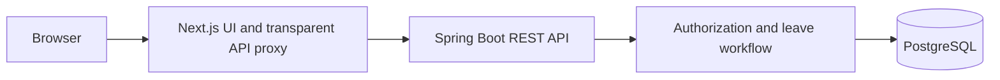
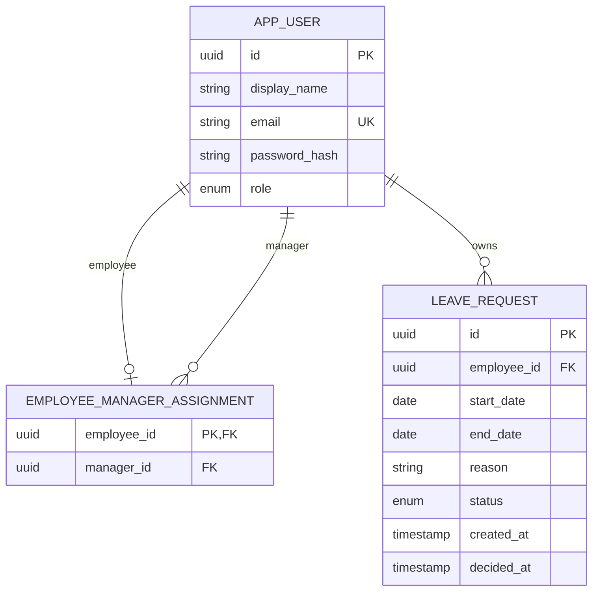

# Architecture Spine — Employee Leave Demo

## Design Paradigm

Layered web application. The Next.js App Router frontend owns presentation and a transparent same-origin proxy boundary; Spring Boot owns authentication, authorization, domain validation, and persistence; PostgreSQL is the sole source of truth.

## Invariants & Rules

### AD-1 — Spring Boot owns identity and authorization [ADOPTED]

- **Binds:** FR-1, FR-3, FR-5, FR-6, FR-7
- **Prevents:** Frontend-only access control, spoofed roles, and cross-user data access.
- **Rule:** Every protected backend operation derives the principal and role from the server-side session. Resolve request ownership from that principal and manager authority from the persisted assignment. Never accept an employee or manager ID as authority from the browser. Employees may read only their own requests; Managers may read and decide only requests for employees assigned to them. Return no protected request fields on a denied lookup.

### AD-2 — Same-origin proxy preserves the session boundary [ADOPTED]

- **Binds:** FR-1, FR-3, frontend/backend integration
- **Prevents:** Cookie/CORS drift and browser access to backend internals.
- **Rule:** The browser calls `/api/*` on the Next.js origin. Next.js forwards API traffic to Spring Boot without interpreting roles or deciding access, forwards the browser Cookie and request body, and passes `Set-Cookie` and backend responses through. The backend is not directly exposed as a browser API. Use an HttpOnly session cookie with `SameSite=Lax`; local HTTP may omit `Secure`, while HTTPS environments must set it.

### AD-3 — Session authentication precedes CSRF checks

- **Binds:** Authentication and all POST operations
- **Prevents:** Cross-site requests using an ambient session cookie.
- **Rule:** Keep Spring Security CSRF protection enabled. `GET /api/auth/csrf` returns the CSRF header name and token. The browser supplies that token as `X-CSRF-TOKEN` for POST requests, and the Next.js proxy forwards the header unchanged. Configure the Spring Security filter chain and exception handling to enforce authentication-before-CSRF for session-protected POSTs; an API contract declaration alone is insufficient. A missing, expired, or invalid session returns 401 even when the CSRF header is missing or invalid; a valid session with a missing or invalid CSRF token returns 403. Login is not session-protected and keeps its separate contract: it requires a valid CSRF token but does not require an existing session. CSRF tokens are not authorization credentials.

### AD-4 — PostgreSQL owns roles, assignments, leave state, and schema history [ADOPTED]

- **Binds:** FR-1, FR-4, FR-5, FR-6, FR-7
- **Prevents:** Divergent ownership, schema, or workflow state across services.
- **Rule:** Store users with a display name and their Employee/Manager role in PostgreSQL. The stored display name is the authoritative source for the existing `GET /api/me` and Manager request response names. Persist the Employee-to-Manager assignment and each leave request in the same database. Flyway is the sole schema-change mechanism and the backend owns one ordered migration history. Versioned SQL migrations live in `backend/src/main/resources/db/migration`, use unique increasing versions, and order prerequisites before dependent migrations. A versioned Flyway migration enables PostgreSQL `pgcrypto` before the demo seed runs. Do not mix Hibernate DDL generation or `schema.sql`/`data.sql` schema initialization with Flyway. Run migrations during Spring Boot startup before backend readiness. Include `spring-boot-starter-flyway` and `org.flywaydb:flyway-database-postgresql`, with dependency versions managed by Spring Boot. A request has one Employee owner, ISO calendar dates, a trimmed 1–500 character reason, Pending/Approved/Rejected status, creation time, and nullable decision time. Only a Pending request can transition once to Approved or Rejected; enforce the transition atomically.

### AD-5 — API shapes are shared and role-specific [ADOPTED]

- **Binds:** FR-1 through FR-7
- **Prevents:** Frontend/backend disagreement about authority, identity, and status fields.
- **Rule:** `contracts/openapi.yaml` is the source contract. Login accepts credentials only; leave creation accepts dates and reason only; decisions accept exactly APPROVED or REJECTED. No request body field can set owner, role, initial status, manager, or rejection reason. GET `/api/me` returns the authenticated identity and role used by the frontend to select a dashboard.

### AD-6 — Local demo provisioning is outside the browser flow [ADOPTED]

- **Binds:** FR-1, FR-2, seed data, local operations
- **Prevents:** Committed plaintext credentials or an accidental registration/admin surface.
- **Rule:** Keep `compose.yaml` limited to the regular frontend, backend, and PostgreSQL services. Define the explicitly invoked, one-shot seed service and its Compose secret in `compose.seed.yaml`, so ordinary `docker compose up` does not require demo credentials. `DEMO_SEED_SQL_FILE` points to the developer's owner-readable SQL file outside the repository, for example `~/.config/employee-leave-demo/demo-seed.sql`. Invoke seeding with `DEMO_SEED_SQL_FILE="$HOME/.config/employee-leave-demo/demo-seed.sql" docker compose -f compose.yaml -f compose.seed.yaml run --rm seed`. The seed service waits for PostgreSQL health and backend health, which is reported only after Flyway startup succeeds; it mounts the external file read-only at `/run/secrets/demo-seed.sql` and runs it with `psql -v ON_ERROR_STOP=1`. Never log the file contents or put credential values in tracked files. The SQL seed uses a transaction; generate each salted BCrypt hash with PostgreSQL `pgcrypto` using `crypt(password, gen_salt('bf', 10))`, and store only the hashes. Spring Security verifies the resulting BCrypt hashes; Story 3 verifies login against both seeded hashes. A missing secret or hashing function, or any seed error, fails without partial seed data or defaults. Do not use PostgreSQL initialization scripts or expose account, role, or assignment provisioning through the API. Do not provide registration, Admin functionality, Keycloak, notifications, or production deployment in this pass.

### AD-7 — Validation uses calendar-day rules [ADOPTED]

- **Binds:** FR-4, OpenAPI create request
- **Prevents:** Different date and reason semantics in UI and API.
- **Rule:** Dates are `YYYY-MM-DD`; start must be today or later; end must be on or after start. Ranges are inclusive and count calendar days; same-day leave is valid. Apply no weekend or public-holiday policy. Trim reason before checking length; reject empty or over-500-character values. **[ASSUMPTION]** The local demo uses `Europe/London` to determine today; revisit if the demo runs in another timezone.

### AD-8 — Frontend preserves the keyboard interaction contract [ADOPTED]

- **Binds:** Login, Employee request, Manager review and decision surfaces
- **Prevents:** A visually complete flow that cannot be completed or followed by keyboard.
- **Rule:** Every interactive control in the Next.js UI works by keyboard; focus order is logical and focus remains visible. After a successful Manager decision, move focus to that request's updated Status and announce the final Status. The proxy must not claim success before Spring Boot confirms it.

## Dependency Direction



## Consistency Conventions

| Concern | Convention |
| --- | --- |
| Naming | JSON fields use lower camel case; role and status enums use uppercase values. |
| Data and formats | IDs are opaque UUID strings. Dates are ISO 8601 calendar dates (`YYYY-MM-DD`); timestamps are UTC RFC 3339. Request lists are role-scoped and returned newest first. |
| Errors | Use `application/problem+json` with `type`, `title`, `status`, `detail`, and optional field `errors`; never echo protected data. Validation is 400, unauthenticated is 401, role denial is 403, missing or unassigned request is 404, stale decision is 409, unexpected failure is 500. |
| Auth/state | Session cookie is HttpOnly, SameSite=Lax, and Secure under HTTPS. Mutating requests require the CSRF header. Role and ownership are always rechecked in Spring Boot. |
| Mutation | Decision is one atomic Pending-to-terminal transition. A repeat decision returns 409 and leaves the stored result unchanged. |

## Stack Seed

| Name | Version |
| --- | --- |
| Next.js | 16.4.6 (App Router) |
| TypeScript | 5.x |
| Node.js runtime | 26 LTS |
| Java | 25 (supported by Spring Boot 4.1.2) |
| Spring Boot | 4.1.2 |
| Maven Wrapper | Maven 3.9.x wrapper |
| PostgreSQL | 18.7 |
| Docker Compose | Compose v2 |
| OpenAPI | 3.1.0 |

Use the exact versions specified above and retain the stated version lines for the other tools. Do not add extra patch pins or image digests.

## Structural Seed

```text
repository/
  frontend/                 # Next.js UI and same-origin /api proxy
  backend/                  # Spring Boot API, security, domain, persistence; Maven Wrapper
    src/main/resources/db/migration/ # versioned Flyway SQL migrations
  contracts/openapi.yaml    # Browser-visible REST integration contract
  compose.yaml              # frontend, backend, and PostgreSQL services only
  compose.seed.yaml          # opt-in one-shot seed service and external Compose secret
  .env.example              # variable names and safe placeholders only
```



The initial seed contains one Employee, one Manager, and their assignment. There is no Admin role.

## Capability → Architecture Map

| Capability / Area | Lives in | Governed by |
| --- | --- | --- |
| Sign in/out and identity | Spring Security session endpoints; Next.js proxy | AD-1, AD-2, AD-3, AD-5 |
| Role-specific dashboard selection | Next.js UI via GET `/api/me` | AD-1, AD-5 |
| Keyboard access and decision feedback | Next.js UI | AD-8 |
| Create/list employee requests | Spring Boot leave API and PostgreSQL | AD-1, AD-4, AD-5, AD-7 |
| Manager list and decision | Spring Boot leave API and PostgreSQL | AD-1, AD-4, AD-5 |
| Local demo seed and services | Compose and backend seed configuration | AD-6 |

## Deployment & Operations Envelope

- The default local Compose application stack is defined in `compose.yaml` and runs only Next.js, Spring Boot, and PostgreSQL. Keep the seed service and its secret in `compose.seed.yaml`; normal `docker compose up` must not require the external demo credential file. Set `DEMO_SEED_SQL_FILE` to the developer-created SQL file outside the repository, then explicitly run `DEMO_SEED_SQL_FILE="$HOME/.config/employee-leave-demo/demo-seed.sql" docker compose -f compose.yaml -f compose.seed.yaml run --rm seed`.
- PostgreSQL health uses `pg_isready`. Spring Boot applies Flyway migrations during application startup; a migration failure fails application startup, so backend readiness cannot report healthy. The existing internal `GET /internal/ready` probe runs `SELECT 1` and returns ready only when PostgreSQL is reachable. Compose invokes this probe for backend health, then waits for backend health before starting the frontend.
- The one-shot `seed` service in `compose.seed.yaml` waits for PostgreSQL health and backend health; backend health is unavailable until Flyway startup succeeds. It mounts `DEMO_SEED_SQL_FILE` read-only at `/run/secrets/demo-seed.sql` as a Compose secret and runs `psql` with `ON_ERROR_STOP` inside a single SQL transaction. Keep the file owner-readable only; never put its contents in an image, build argument, or service logs. PostgreSQL `pgcrypto` computes hashes with `crypt(password, gen_salt('bf', 10))`. Do not seed through PostgreSQL initialization scripts or a public API.
- Next.js exposes an internal health probe after startup. Health probes are not product API operations. Keep database and backend ports private to the Compose network; publish only the frontend port. Persist PostgreSQL in a named local volume. `.env` holds PostgreSQL runtime credentials only; demo credentials stay in the separate external seed SQL file.
- No production deployment, external identity provider, notifications, or operational service-level target is defined.

## Deferred

- Pagination, filtering, and ordering extensions: unnecessary for one Employee/one Manager seed; revisit if list sizes grow.
- Whether the decision confirmation dialog ships: UX assumption, not an API contract.
